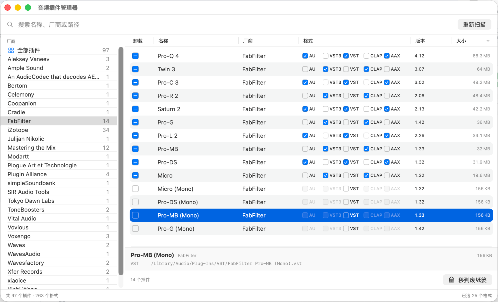

# AudioPluginManager

macOS 上最简单、轻量化的音频插件管理器。

由于最近主播电脑上装了太多雷霆音频插件，电脑重负不堪，空间告急，遂使用DeepSeek构建了一个轻量化的音频插件管理器!



没错，就是这么简单！

## 构建

需要 macOS 14+ 和 Swift 6 工具链（用 Command Line Tools 即可，不需要完整的 Xcode）。

```bash
cd path/to/MacAudioPluginManager
./build.sh
```

`build.sh` 会：

1. 用 `swift build -c release` 构建 Swift Package；
2. 在 `build/Plugin Manager.app` 组装可双击的 app bundle；
3. 做 ad-hoc codesign。

## 打开

```bash
open "build/Plugin Manager.app"
```

也可以在 Finder 里双击 `build/Plugin Manager.app`。

## 主界面

- 扫描：
  - `/Library/Audio/Plug-Ins/Components`（AU）
  - `/Library/Audio/Plug-Ins/VST3`
  - `/Library/Audio/Plug-Ins/VST`
  - `/Library/Audio/Plug-Ins/CLAP`
  - `~/Library/Audio/Plug-Ins/Components`（AU）
  - `/Library/Application Support/Avid/Audio/Plug-Ins`（AAX）
- 同一个插件的不同格式合并成一行，合并键为「厂商 + 插件名」；大小写、空格和常见公司后缀都不敏感。
- VST/VST3/CLAP 名称里重复的厂商前缀会去掉，例如 `FabFilter Pro-Q 4` 显示为 `Pro-Q 4`，这样才能和 AU/AAX 的同名条目合并。
- 厂商名不同的同一产品用一张小别名表兜底；别名只改变分组键，仍然要求插件名归一化后一致才会合并。
- 「格式」列固定显示 AU / VST3 / VST / CLAP / AAX 五个紧凑复选框。插件没有的格式显示为灰色、不可点。
- 左侧行复选框控制该插件已有的全部格式；单独点某个格式复选框只改该格式。部分选中时行复选框显示横线。
- 「移到废纸篓」只处理实际勾选的格式，未勾选的格式不动。
- 「名称」「厂商」「版本」「大小」列头都可点击排序，再点一次切换正序/倒序；版本按数字段比较，格式列不排序。
- 「大小」是该行所有格式的大小合计。
- 路径列已去掉；点选某一行后，列表下方会显示这个插件所有格式的路径。
- 左侧厂商列表使用更紧凑的行距，一屏能显示更多厂商。
- 目录大小在后台线程递归统计，完成后一次性更新界面，不阻塞 UI；不加载任何插件二进制。

一次实际扫描的结果：262 个格式条目合并为 96 行。

## 厂商提取顺序

1. AU/AAX：`AudioComponents[].name` 中冒号前的厂商名；没有冒号时用 `AudioComponents[].description`。
2. VST3：`Contents/Resources/moduleinfo.json` 的 `Classes[].Vendor`。
3. 代码签名证书里的 `Developer ID Application: ...`（等价于 `codesign -dvv` 的 `Authority`）。
4. `CFBundleIdentifier` 中第一个有意义的段。
5. 以上都没有时归为“未知”。

最后会对大小写、标点和常见公司后缀（Inc、LLC、GmbH 等）做一次厂商名归并，避免同一厂商被拆成多组。

## 说明

不实现 privileged helper。`/Library` 下的插件如果因为权限无法移到废纸篓，弹窗会显示系统返回的原因和错误码；这一版不做提权。
